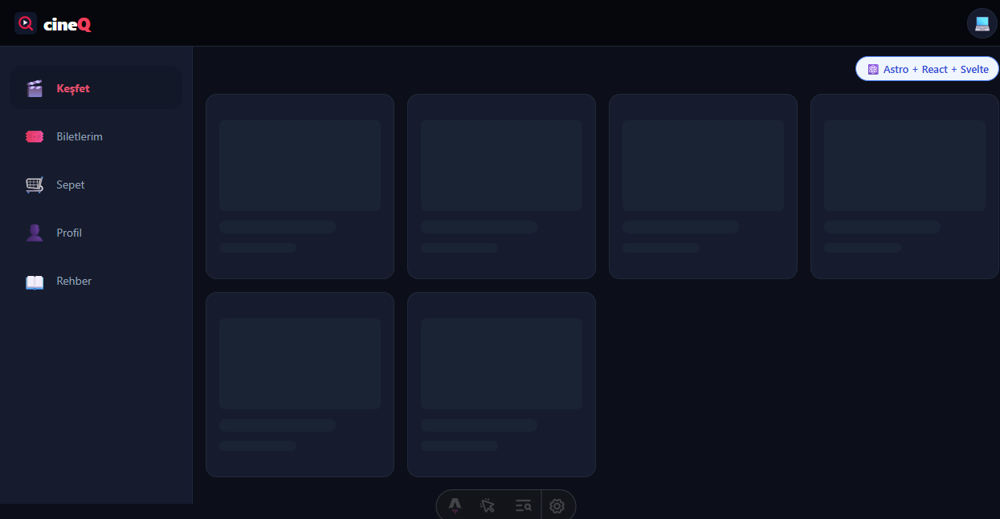
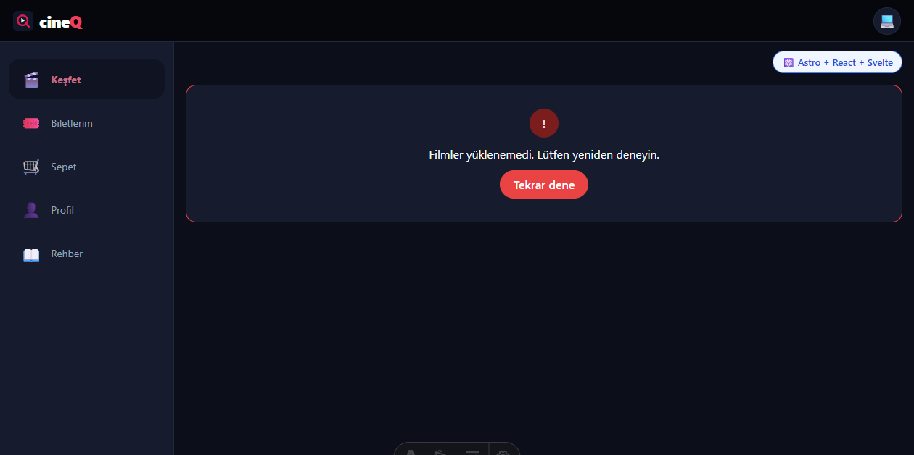
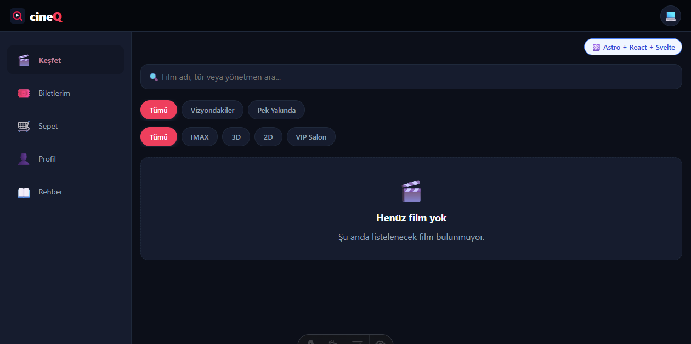
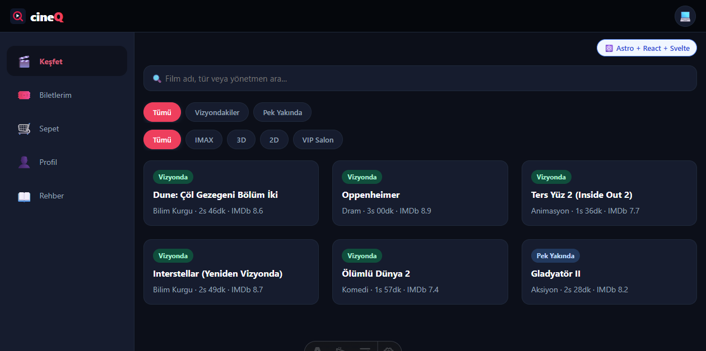

# Görev 13 — Liste Ekranı ve Üç Durum

## Araç ve model

- Araç: Copilot SDK in VS Code.
- Model: Bu oturumda model adı gösterilmedi.

## İstem

Bu depoda Görev 13 (Liste Ekranı ve Üç Durum) çalışmasını gerçekleştireceğiz.
Projemiz CineQ: Svelte 5, Astro ve Rust (Tauri) tabanlı bir sinema ve büfe
rezervasyon/sipariş masaüstü uygulamasıdır.

AGENTS.md çalışma döngüsü kuralı gereğince ÖNCE SADECE PLANINI SUN, BEN
ONAYLAYINCA DEĞİŞİKLİKLERİ UYGULA.

Gereksinimler ve Yapılacaklar:
1. `docs/tasks/week-4/13-liste-ve-uc-durum.task.md` şartnamesine tam uyum sağla.
2. `src/lib/components/ui/` altında 3 genel bileşen oluştur (Svelte 5 Runes ile):
   - `Yukleniyor.svelte`: Kart ızgarasına uygun iskelet (skeleton) yüklenme animasyonu.
   - `BosDurum.svelte`: baslik, aciklama, isteğe bağlı dugmeMetni ve tikla callback olayı.
   - `HataDurumu.svelte`: hata mesaji ve "Tekrar dene" butonu/callback olayı.
   - Tüm bileşenlerde renkler, kenarlıklar ve boşluklar `src/styles/app.css` token'larından gelmeli; bileşenlerde sabit renk kodu kullanılmamalıdır.
3. Ana liste ekranımızda (`src/components/Kesfet.svelte`):
   - Veriyi tek bir yükleme işlevinden alacak bir yapı kur.
   - Ekran birbirini dışlayan 4 halden yalnız birini göstersin: 'yukleniyor', 'hata', 'bos', 'dolu'.
   - Arama kutusu veya tür/format süzgeçleri sonucu boş liste dönerse `BosDurum` gösterilsin ve "Filtreleri Temizle" düğmesi sunulsun (düğmeye basınca arama/süzgeç sıfırlansın).
4. İkinci liste ekranı:
   - Uygulamadaki ikinci liste ekranına da (`Biletlerim` veya `Sepet` / `Bufe` ekranı, örneğin bilet geçmişi veya büfe listesi) aynı 3 bileşeni bağla (örneğin bilet yoksa boş durum mesajı).
5. Çoklu Dil Desteği:
   - Bu üç durumun tüm metinlerini (Yükleniyor, Hata oluştu, Tekrar Dene, Sonuç bulunamadı, Filtreleri Temizle vb.) projenin 4 diline de (TR, EN, AR, FA) uygun sözlük/i18n dosyalarına ekle.
6. Test Kolaylığı:
   - Bu 4 hali elle test edebilmemiz için geliştirme sırasında URL parametresiyle simüle edilebilecek bir mekanizma ekle (örn: `?durum=yukleniyor`, `?durum=hata`, `?durum=bos`).
   - Bu yöntemi `docs/gelistirme-notlari.md` belgesine yaz ve `AGENTS.md` doküman indeksine ekle.
7. İstem günlüğünü `docs/istemler/13-liste-ve-uc-durum.md` olarak oluştur; plan, düzeltmeler, doğrulama çıktıları ve 4 halin test sonuçlarını yaz.
8. `bun run check` ve `bun run build` komutlarının 0 hata vermesini sağla.

Önce mevcut durumu incele, planını ve dokunacağın dosyaları listele; onayım
olmadan kod değiştirme.

[Aynı Şekilde Sende bu planı gözden geçir ve eksiklik varsa belirt ve eklemek
için izin iste]

## Plan

Önce şartname, Keşfet ve Biletlerim ekranları, bilet deposu, tema token'ları,
AGENTS indeksi ve istem günlüğü biçimi incelendi. Değişikliklerden önce dosya
listesi ve plan kullanıcıya sunuldu. Kullanıcı planı “Onaylıyorum, uygula”
yanıtıyla onayladı.

Onaylanan plan; üç genel Svelte 5 durum bileşenini, ortak TR/EN/AR/FA metin
kaynağını, Keşfet ve Biletlerim durum akışlarını, geliştirme modunda URL
simülasyonunu, bilet deposundaki okuma hatasını boş listeden ayırmayı,
geliştirme notlarını, AGENTS indeksini, i18n klasörünün mimari açıklamasını ve
dört ekran görüntüsü kanıtını kapsadı.

## Düzeltmeler

Kullanıcıdan ek düzeltme talebi gelmedi. Uygulama sırasında filtre sonucu boş
olduğunda görünür durumun da `bos` olması sağlandı; hata yakalamaları ekrana
hata durumu taşır ve konsola hata kaydı yazar.

## Doğrulama sonucu

- `bun run check`: başarılı; 0 hata ve 0 uyarı. Mevcut, görev dışı
  `CanliRozet.tsx` dosyasındaki kullanılmayan React importu için 1 bilgi notu.
- `bun run build`: başarılı; 26 statik sayfa üretildi.
- `git diff --check`: başarılı; boşluk hatası yok.
- Tarayıcı doğrulaması:
  - `?durum=yukleniyor`: skeleton ızgarası gösterildi.
  - `?durum=hata`: hata metni ve tekrar dene düğmesi gösterildi; düğme
    parametreyi kaldırıp altı filmlik listeyi yükledi.
  - `?durum=bos`: boş liste bileşeni gösterildi.
  - `?durum=dolu`: altı film kartı gösterildi.
  - Eşleşmeyen arama boş durumunu açtı; **Filtreleri Temizle** aramayı sıfırlayıp
    altı filmi geri getirdi.
  - Biletlerim hata durumu, tekrar deneme sonrası boş bilet durumu doğrulandı.
  - TR, EN, AR ve FA boş durum metinleri doğrulandı; AR/FA RTL yönüyle denendi.
- Ekran görüntüleri:

  | Durum | Kanıt |
  |---|---|
  | Yükleniyor |  |
  | Hata |  |
  | Boş |  |
  | Dolu |  |
