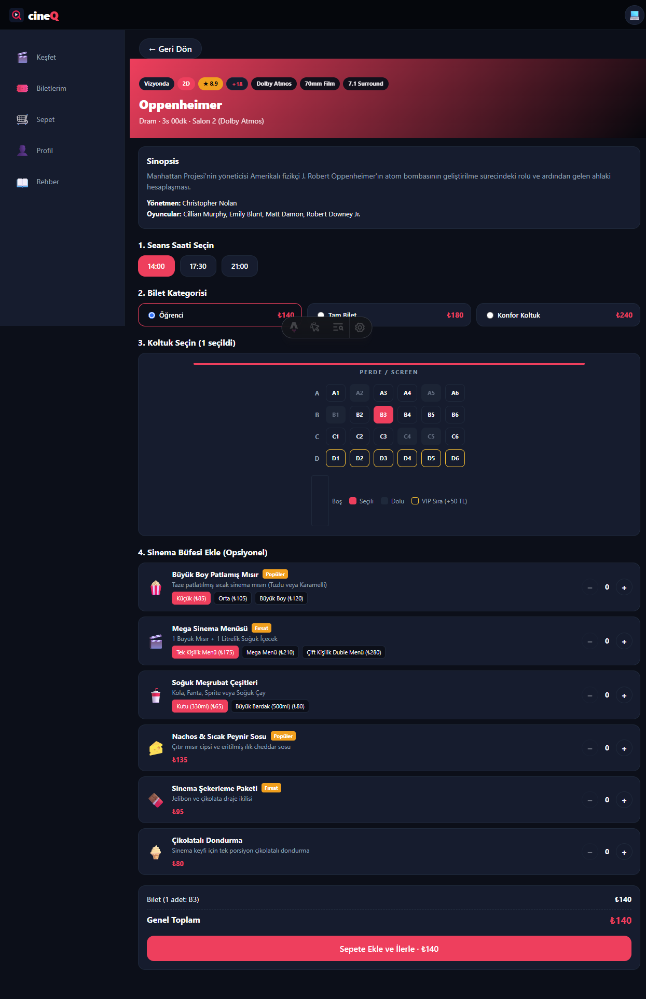
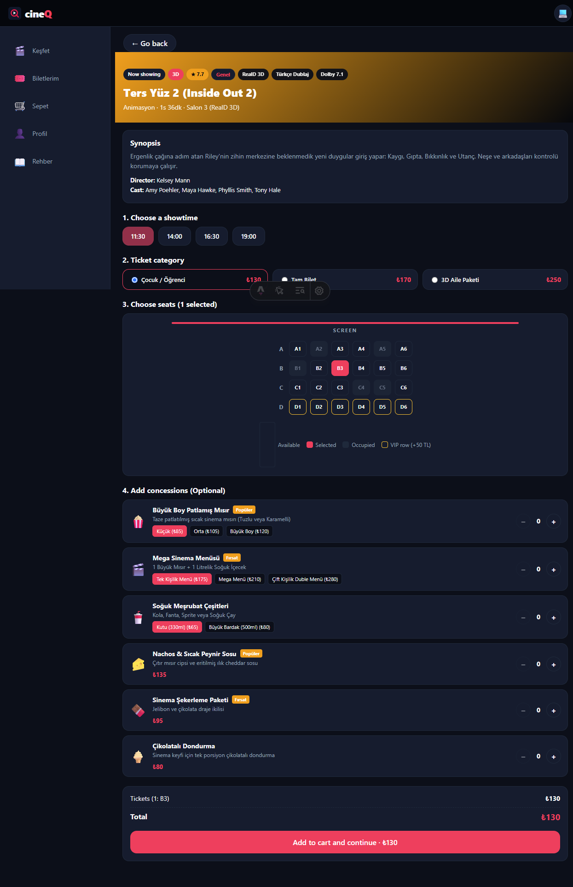
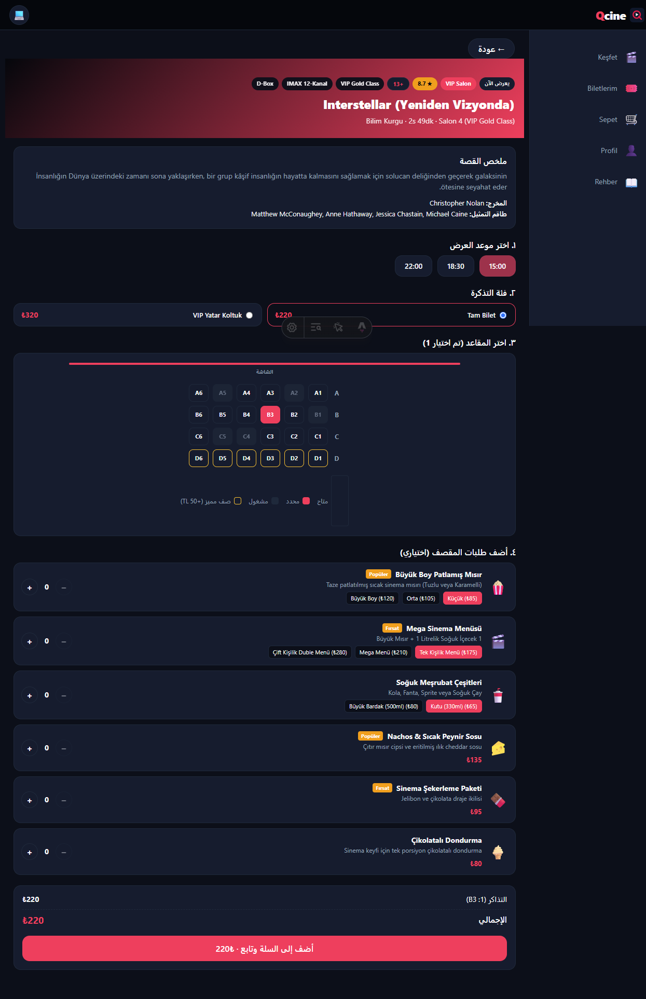
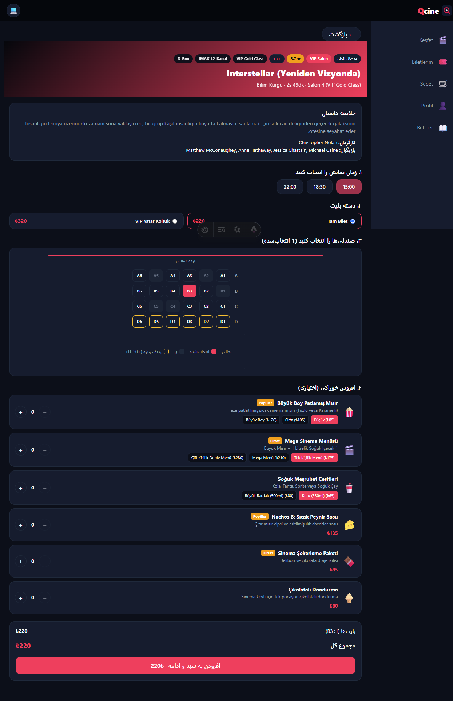
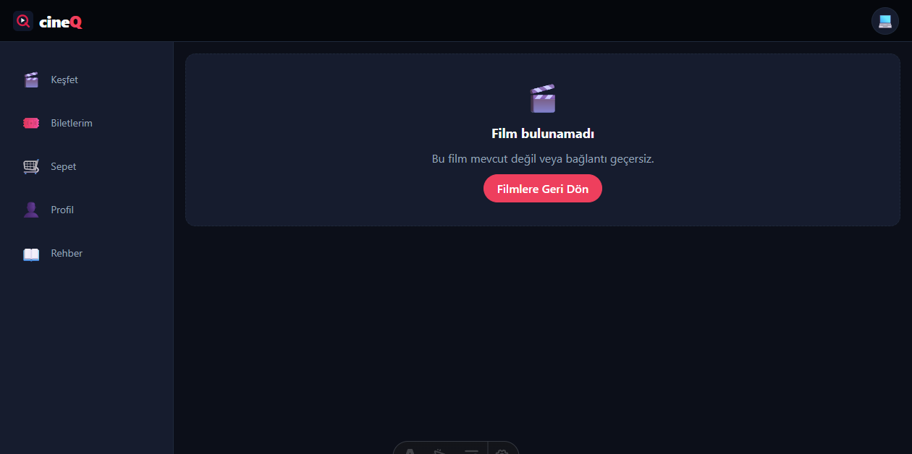

# Görev 14 — Detay Ekranı ve Gezinme

## Araç ve model

- Araç: Copilot SDK in VS Code.
- Model: Bu oturumda model adı gösterilmedi.

## İstem

Bu depoda Görev 14 (Detay Ekranı ve Gezinme) çalışmasını gerçekleştireceğiz.
Projemiz CineQ: Svelte 5, Astro ve Tailwind CSS tabanlı sinema ve büfe
biletleme arayüzüdür.

AGENTS.md çalışma döngüsü kuralı gereğince ÖNCE SADECE PLANINI SUN, BEN
ONAYLAYINCA DEĞİŞİKLİKLERİ UYGULA.

Gereksinimler ve Yapılacaklar:
1. `docs/tasks/week-4/14-detay-ekrani.task.md` şartnamesine tam uyum sağla.
2. Film detay ekranı rotası:
   - Çok dilli Astro rotası düzenine uygun olarak `/[lang]/film/[id]` (veya
     `src/pages/[lang]/film/[id].astro` dinamik rotası, getStaticPaths ile
     4 dil x 6 film = 24 sayfa) ve olmayan ID'ler için SSR/istemci tarafı hata
     yakalama kurgula.
   - Keşfet ekranındaki film kartlarına tıklandığında ilgili filmin detay
     rotasına (`/${lang}/film/${film.id}`) yönlendirilsin.
3. Detay ekranında gösterilecek alanlar:
   - Film adı, afiş/placeholder görseli, açıklama/özet, tür, süre, yönetmen,
     IMDb puanı, vizyon durumu, salon formatı ve seans saatleri listesi.
   - Bilet alma/seans seçme butonları veya akışı.
4. Geri dönüş ve durum koruma (Önemli):
   - Detay ekranında belirgin bir "Geri Dön" düğmesi olsun.
   - Kullanıcı Keşfet ekranında arama yapmış veya süzgeç seçmişken bir karta
     tıklayıp detaya gider ve ardından geri dönerse (ister geri butonuyla
     ister tarayıcı geri tuşuyla), arama metni ve seçilen süzgeçler kaybolmasın
     (URL query string `?ara=...&tur=...` veya yerel hafıza/store ile durum
     korunsun).
5. Bulunamadı (Not Found) Hali:
   - Geçersiz veya olmayan bir film kimliği (`/tr/film/999` vb.) ile
     girildiğinde Görev 13'te oluşturduğumuz `HataDurumu` / `BosDurum` bileşeni
     kullanılarak anlamlı bir "Film bulunamadı" ekranı ve "Filmlere Geri Dön"
     düğmesi gösterilsin (boş/çöken sayfa olmasın).
6. Çoklu Dil & RTL:
   - Detay ekranı ve hata durumu 4 dilde de (TR, EN, AR, FA) kusursuz derlensin;
     AR ve FA dillerinde sağdan sola (RTL) düzen bozulmasın.
7. Dokümantasyon ve Mimari:
   - `docs/mimari-agac.md` içindeki sayfa ağacını yeni detay rotasını yansıtacak
     şekilde güncelle.
   - `docs/istemler/14-detay-ekrani.md` görev günlüğünü oluştur (plan,
     düzeltmeler, doğrulama çıktıları ve kanıtlar).
8. `bun run check` ve `bun run build` komutlarının 0 hata vermesini sağla.

Önce mevcut durumu incele, planını ve dokunacağın dosyaların listesini göster;
onayım olmadan kod değiştirme.

[Sende incele ve bu plana eklenecek bir şey varsa eksik falan söyle ve eklemek
için benden izin al]

## Plan

Değişiklik öncesinde Görev 14 şartnamesi, mevcut `EtkinlikDetay.svelte`,
`Kesfet.svelte`, Film tipi/verisi, Astro statik rota yapısı, dil/RTL düzeni ve
mimari ağaç incelendi. Kullanıcıya mevcut eksikler, dokunulacak dosyalar,
doğrulama ve Türkçe rota tercihi içeren plan sunuldu.

Kullanıcı şu rotalama kararını onayladı: mevcut dil düzeni korunsun; Türkçe
detay `/film/{id}`, diğer diller `/en/film/{id}`, `/ar/film/{id}` ve
`/fa/film/{id}` olsun. Her dildeki altı film için toplam 24 statik detay sayfası
üretilecek.

Onaylanan plan; var olan seans/bilet/koltuk/büfe akışını korumayı, detay
metinlerini dört dile çevirmeyi, geçersiz kimlikte Görev 13 boş durum bileşenini
kullanmayı, arama ve süzgeçleri URL'de saklamayı, geri dönüşü ve doğrudan URL
açılışını sınamayı, mimari ağacı ve bu günlüğü güncellemeyi kapsıyordu.

## Düzeltmeler

- Görev 13'ün geliştirme simülasyonu zaten `durum` query parametresini
  kullandığından liste görünüm filtresi URL'de `durum` yerine `vizyon` anahtarı
  ile saklandı; böylece `?durum=hata` benzeri geliştirme kontrolleri korunuyor.
- Türkçe dışındaki detay sayfalarında geri dönüş hedefinin bulunması için
  mevcut dil rotası düzenine uygun EN/AR/FA Keşfet giriş rotaları eklendi.
- Film modelinde afiş dosyası bulunmadığı için detay üst alanında mevcut
  temaya bağlı renkli placeholder kullanıldı. Film başlıkları, kişi adları,
  büfe ürün adları ve kaynak modeldeki sinopsisler mevcut örnek verideki
  biçimleriyle bırakıldı; ekran etiketleri dört dile çevrildi.

## Doğrulama sonucu

- `bun run check`: başarılı; 0 hata, 0 uyarı. `CanliRozet.tsx` dosyasındaki
  kullanılmayan React importu için mevcut bir bilgi notu raporlandı.
- `bun run build`: başarılı; 54 statik sayfa üretildi. Bunların 24'ü yeni film
  detay rotalarıdır; özel `404.html` da üretildi.
- `git diff --check`: başarılı; boşluk hatası yok.
- HTTP istekleri `/film/1/`, `/en/film/2/`, `/ar/film/3/`, `/fa/film/4/` için
  `200 OK` döndürdü.
- Tarayıcı senaryoları:
  - Üç farklı kartta (film 1, 3 ve 6) doğru detay başlığı ve kimlikli URL
    doğrulandı.
  - Filtreli Keşfet ekranından karta gidildi; detaydaki **Geri Dön** ile ve
    tarayıcı geri tuşuyla dönüşte arama (`ara`) ve salon (`salon`) filtreleri
    korundu.
  - Vizyon süzgecinin `vizyon=pek-yakinda` parametresiyle seçili duruma geri
    yüklendiği doğrulandı.
  - EN/AR/FA detayları doğrudan URL ile açıldı; başlık/arayüz dili ve HTML
    `lang`/`dir` değerleri doğrulandı (AR/FA `rtl`).
  - Olmayan `999` kimliği TR/EN/AR/FA adreslerinde denenerek yerelleştirilmiş
    “Film bulunamadı” görünümü ve dönüş düğmesi doğrulandı.
- Ekran görüntüleri:

  | Kanıt | Görüntü |
  |---|---|
  | Türkçe detay |  |
  | İngilizce detay |  |
  | Arapça RTL detay |  |
  | Farsça RTL detay |  |
  | Bulunamadı |  |
